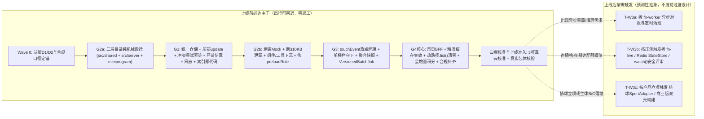

# 中央民族大学石榴籽体育管理小程序 · 系统性架构治理与演进总规划（v2 定稿）

> **版本与基线**：`v2 定稿` · 代码复核基线 `f2ca8fe`（第二十四轮审查补修后） · 实测真值（`doc-truth.js`）：**44 页**（主包 5 + 分包 39）、协议 2 action **202 个**（`IDENTITY` 14 / `SPACE` 119 / `EXCHANGE` 16 / `MEET` 53）、集合 **52 个**、云端镜像 **100 个**、自动化测试 **205 文件 / 3,343 用例**（全部运行于 Node 内存仓储）。
>
> **核心前提**：**重构完成前不上线、无历史数据迁移包袱、追求长期不返工与主包体积越小越好**。本规划吸收了两轮独立审查的有效纠偏，明确区分「约束结构的底座投入」与「预测未来的提前抽象」，以**串行可回退主干 + 非阻塞云端校准**取代盲目大爆炸重构。

---

## 一、治理原则与范围边界

### 1.1 原则 1：串行主干、底座优先，不做过渡性补丁

由于当前没有上线倒计时，不需要走「先在旧结构上打短期补丁上线 → 几周后重构再全部推翻」的线性弯路。以下 **5 项过渡性补丁明确放弃**，直接按串行拓扑做终局结构：

| 序号 | 明确放弃的过渡补丁（会返工） | 一步到位的终局做法 |
|---|---|---|
| 1 | 在双份手写仓储上分别打补丁 | 先完成 `G2a` 机械分层，再在 `G1` 合并 [school-memory-repo.js](../miniprogram/services/school-memory-repo.js) 复用 [school-repository.js](../cloudfunctions/data/src/school-repository.js) 内核，落齐字段级 `update`、冲突重试与严苛仿真器 |
| 2 | 仅靠 `packOptions.ignore` 遮掩滞留主包的 1.33 MB 服务端/Mock 代码 | 落地 `src/shared/` + `src/server/` + `miniprogram/` 三层物理分层，`G2a` 先机械搬迁、`G2b` 剥离 Mock 与瘦身，从物理结构上杜绝客户端误引服务端 |
| 3 | 在单体 [cloudfunctions/data](../cloudfunctions/data/index.js) 内部继续堆聚合接口并直接删缓存失效 | 保留 `G3 → G4` 严格依赖：先在 `G3` 解耦 `touchEvent` 对 `sportsMeets` 的热点写（并给运动会单独的失效粒度），再在 `G4` 精准收敛 `contextCache` 失效范围 |
| 4 | 为同步写链路里的 [season-points.js](../miniprogram/services/season-points.js) 继续打全量重算补丁 | 补齐赛事结算增量更新，日常写链路不再全扫 4 表；全量对账修复移至上线后异步/定时触发的 `fn-worker` |
| 5 | 继续手工维护散文式 [数据库索引清单.md](数据库索引清单.md) | 在 `G1` 同步立起 `config/db-indexes.json`（索引即代码）与结构化 JSON 日志，让每一步重构自带可观测与 CI 守卫 |

### 1.2 原则 2：严格区分「约束结构」与「预测性抽象」

「为长远着想」的核心是**让未来的改动便宜**，而不是**现在就把还没立项的未来全造出来**。提前做预测性抽象，一旦产品口径变化，本身就是最大的返工。

| 类别 | 定义 | 本规划清单 | 处理策略 |
|---|---|---|---|
| **约束结构** | 让后续修改更便宜、代价一次性且不依赖未定产品需求 | 三层物理分层（`G2a`/`G2b`）、统一仓储与局部 `update`（`G1`）、版本栅栏与 `VersionedBatchJob`（`G3`）、热点解耦与读写治理（`G4` 核心）、索引即代码与结构化日志、合规底线 | **上线前必做** |
| **预测性抽象** | 为尚未立项或未定型的需求提前引入复杂度 | 排球 `SportAdapter` 插件化（排球未立项）、商业双壳构建（主体方案 B/C 未拍板）、拆 6 个云函数、多容器 Redis `StateStore`、客户端 `watch()` 推送 | **上线后按触发条件再做** |

### 1.3 原则 3：为什么不设阻塞式 Wave 0.5 探针

初版曾考虑在开工前设一个阻塞所有编码的「真实云端探针阶段」。经复核，**阻塞式前置探针没有必要**，理由有三：

1. **包体积维度**：一旦基于结构价值决定落地三层物理分层，主包体积原则就是**「越小越好」**，不再拿「当前编译包体是否接近 2 MB」当作要不要分层的判断前提。开发者工具包体检查退居 `G2b` 完成后的结果验真。
2. **事务预算维度**：我们**主动放弃**高风险的「跳过存在性检查的 `createNew`」捷径，改用「聚合快照 + 批大小可配置的 `VersionedBatchJob`（默认保守每批 ≤ 60 ops）」从结构上绕开单事务操作上限，因此 `G2a / G1 / G2b / G3 / G4` 的核心设计**不依赖 CloudBase 未公示上限的精确数值**。
3. **预测性能力维度**：冷启动耗时、Redis 套餐权限、`watch()` 配额均属于上线后按需触发项，不在上线前主干范围内。

**替代方案**：保留一份**3 项非阻塞「云端校准清单」**（见第六章 6.2 节）——`G1` 先用可插拔错误分类器 `isRetryableTxConflict(err)` 与可配置批常量落地，待测试云环境就绪后跑 5 分钟校准脚本回填参数，并在上线前验收必过，**不阻塞任何主干切片开工**。

### 1.4 非目标（Non-Goals）与首次上线门槛（Go-Live Line）

- **明确非目标**：本阶段不提前开发排球规则与 `SportAdapter` 插件；不提前改造商业版双壳构建（主体方案 B/C 未定前不动）；不接入微信支付/广告主/官方旗舰标（遵守 [主体注册与商用路径备忘](主体注册与商用路径备忘-2026-11-10.md#L255)）；不盲目将单云函数拆成 6 个。
- **首次上线门槛（Go-Live Line）**：必须完成 **Wave 0（决策定锚） → G2a → G1 → G2b → G3 → G4 核心 → 合规底线补齐 → 3 项云端校准验收**。其余（`fn-worker` 之外的函数拆分、Redis `StateStore`、`watch()` 推送、排球与商业双壳）全部留待上线后按触发条件增量演进。

---

## 二、代码现状体检基线（复核于 `f2ca8fe`）

### 2.1 核心指标与实测事实

| 维度 | `f2ca8fe` 实测真值 | 关键校准说明（纠偏常见误判） |
|---|---|---|
| 页面与分包 | **44 页**（主包 5 + 分包 39：`Event` 5 / `Meet` 7 / `Team` 8 / `College` 8 / `Member` 11） | [app.json](../miniprogram/app.json#L117-L138) 对**全部 5 个分包**配置了 `network: "all"` 预下载，抵消按需加载收益 |
| 代码规模 | action **202 个**（14 / 119 / 16 / 53）；集合 **52 个**；镜像 **100 个**；测试 **205 文件 / 3,343 用例** | 全部测试运行于 [school-memory-repo.js](../miniprogram/services/school-memory-repo.js) 内存串行队列，未在真云并发下跑过 |
| 包体积三口径 | 未压缩源码主包 **≈ 2.98 MB**（`services/` 2,166.9 KB 等）；`10-21` 体检压缩实测 **1,273.6 KB**；`README` 记 gzip **939 KB** | 微信 2 MB 限制针对**编译压缩后代码包**（非 gzip）；`10-21` 后主包源码又涨了约 +330 KB，且未计入 `es6: true` 转译膨胀；无论当前是否超限，三层分层后均以**越小越好**为目标 |
| 事务与容量 | 27 文件含 **141 处** `.transaction()`；`set: 419 / update: 24 / insert: 9 / remove: 11` | **纠偏**：[第二十三轮上线复验](第二十三轮上线复验修复-验收记录.md#L12) 已将 10 队循环赛（45 场）压至 **98 次**操作（距 100 仅剩 2 次余量），当前真实超限拒绝阈值是 **11 队（55 场）** |
| 积分与 `.list()` | `season-points.js` 已实现训练签到增量 `applyTrainingFactDelta`；5 个核心服务精确残留 **39 处** `.list()` | 仍触发 4 表全扫的是 `finishSchoolEvent`、`cancelTraining` 及脏态回退；39 处 `.list()` 分布见下方 2.2 可复现命令 |
| 合规与隐私 | 客户端已落地 `__usePrivacyCheck__: true`、`components/privacy-gate`、`packageMember/agreement` | 尚缺后台隐私指引正式填报、14–18 岁公示脱敏策略、内容安全（`msgSecCheck`/`imgSecCheck`）与数据留存/删除机制 |

### 2.2 残余 `.list()` 精确基线（复核于 `f2ca8fe`）

在仓库根目录执行静态扫描（排除注释后精确匹配 `*.list()`），5 个核心服务文件共 **39 处**（须在 `G4` 逐一区分热路径与合法兜底路径后清零热路径扫描）：
- [school-rank-service.js](../miniprogram/services/school-rank-service.js)：**13 处**（含实时聚合回退、积分重算、榜单构建）
- [team-event-service.js](../miniprogram/services/team-event-service.js)：**11 处**（多处全协会 `teams.list()` 仅用于取队名、以及 `teamEvents.list()` / `teamEventEntries.list()` / `teamMembers.list()`）
- [school-college-service.js](../miniprogram/services/school-college-service.js)：**6 处**（`collegeEvents.list()` / `collegeEntries.list()` / `ties.list()` / `lineups.list()`）
- [meet-score-service.js](../miniprogram/services/meet-score-service.js)：**5 处**（`sportsMeetColleges.list()` / `sportsMeetPublications.list()` / `sportsMeetResultRows.list()` / `sportsMeetSessions.list()`）
- [season-points.js](../miniprogram/services/season-points.js)：**4 处**（`refreshAssociationPoints` 全量重算 4 表并发读取）

---

## 三、Wave 0 前置决策与合规底线（开工前一次性定锚）

### 3.1 开工前必须拍板的 3 项轻量决策

> 本项目为单开发者 + AI 协作模式，不引入重型 RACI 流程；仅明确技术决策归口与外部阻塞卡点。

| 决策项 | 拍板结论与归口 | 状态 |
|---|---|---|
| **D1：客户端本地 Mock 模式去留**（核心） | **采用选项 A：取消客户端模拟模式**，开发与演示改用独立开发云环境 + 演示学校数据（客户端零服务端代码）；<br>构建产物策略：**采用选项 A（生成物继续提交入 Git）**，由构建脚本自动生成、禁止手改并由 CI 逐字节守卫。 | **已拍板定案（2026-11-24）** |
| **D2：合规与未成年人脱敏口径** | **按默认推荐定案**：① 明确仅服务年满 14 周岁在校学生；② 公开展示优先昵称，实名/学号场景脱敏为「姓氏 + `*` + 学号后四位」；③ UGC 写入统一接入服务端 `msgSecCheck` / `imgSecCheck`；④ 注销/离校后 30 天内删除个人资料，保留匿名化历史战绩以维持全校 Elo 账本完整。 | **已拍板定案（2026-11-24）** |
| **D3：外部长周期决策隔离** | 主体注册方案（B 学校主体 vs C 双主体）与排球协会正式立项属于**外部异步决策**，从本治理主干解耦，待正式落地后再触发 Wave 3 对应拓展切片。 | **异步推进（不阻塞主干）** |

### 3.2 合规与隐私前置约束（上线前必达）

| 约束域 | 数据分级与当前缺口 | 上线前必做动作 |
|---|---|---|
| **数据分级边界** | **一般个人信息**：姓名、学号、学院、性别、头像、昵称、OpenID、赛事战绩（无体测/金融/精确位置字段）。<br>**红线**：不收集 <14 岁儿童信息（若放开即升级为敏感个人信息，需监护人单独书面同意与影响评估）。 | 注册/身份页增加年龄口径确认与告知；完善隐私政策存储期限（如「账号注销/离校后 30 天内删除或匿名化」）。 |
| **公示最小必要脱敏** | 当前名册与榜单部分视图直接暴露完整姓名/昵称。 | 在服务端 DTO 输出层统一按角色脱敏（普通成员视角展示「姓氏 + 脱敏学号/昵称」），避免隐私政策告知不实。 |
| **内容安全（UGC）** | 公告、小组简介、队名、昵称、头像等用户可填内容尚未接入微信内容安全校验。 | 在服务端写入入口按需接入 `security.msgSecCheck` / `security.imgSecCheck` 统一校验封装。 |
| **数据留存与注销** | 已有离校/停用状态，但缺用户主动发起「账号注销与数据清理/匿名化」闭环及后台隐私指引填报。 | 补齐账号注销/数据导出与清理入口；提审前按 [性能与审核体检](性能与审核体检-2026-10-21.md#L247-L266) 完成后台「收集昵称、头像」指引填报。 |

---

## 四、五大核心问题根因地图与 6 条安全一致性护栏

### 4.1 五大核心问题全景（复核于 `f2ca8fe`）

| 问题域 | 核心根因（代码定位） | 终局消除手段（所属支柱） |
|---|---|---|
| **事务预算上限**<br>（T1–T4） | **T1**：[school-repository.js](../cloudfunctions/data/src/school-repository.js#L80-L99) `buildScoped.write` 写前强制 `io.read` 验归属，新建文档也耗 2 次操作；<br>**T2**：事务内 `freshContext` 固定 5–6 次点读，运动会 `touchEvent` 再加 4 次操作；<br>**T3**：[team-event-service.js](../miniprogram/services/team-event-service.js#L574-L601) `commitEventChange` 在已核对 `event.revision` 后仍逐条 `getById` + `sameRecord` 比对，10 队循环赛已逼近 `98/100` 红线、11 队即失败；<br>**T4**：大规模写按实体数线性展开，缺少聚合快照与可恢复批任务框架。 | `G3`：推广单文档名册/签表快照；`commitEventChange` 收敛为 `event.revision` 单栅栏 + 静态守卫；落地可配置批大小的 `VersionedBatchJob` 彻底解除 100 次上限。 |
| **读写放大**<br>（RW1–RW5） | **RW1**：[school-home-view.js](../miniprogram/services/school-home-view.js#L147-L220) 首屏 6 协会扇出 14–16 次云调用，叠加 [request-pace.js](../miniprogram/services/request-pace.js#L31) 6/s 排队造成 2–3s 延迟；<br>**RW2**：[school-request.js](../cloudfunctions/data/src/core/school-request.js#L73-L81) 将 `saveMeetJudgeScore`/`submitMeetJudgeScore` 列入 `IDENTITY_INVALIDATION_ACTIONS`，每记一分即跨校全清容器缓存；<br>**RW3**：上述 39 处 `.list()` 扫表、`finishSchoolEvent` 触发 4 表重算、`readMatchPage` 翻页多发 2 次 `count`；<br>**RW4**：`buildScoped.update` 底层走 `io.set` 整文档覆写，叠加密集多键索引放大写入；<br>**RW5**：直播 2s 固定轮询在百人观赛时呈百倍放大。 | `G1`：字段级局部 `update`；<br>`G4`：新增 `getSchoolHomeSummary` BFF；在 `G3` 解耦 `touchEvent` 后精准收敛缓存失效；清零热路径 `.list()`；`events.signupCount` 落库；赛事结算全增量积分；翻页跳过冗余 `count`。 |
| **云端静默冲突**<br>（C1–C6） | **C1**：[meet-consistency.js](../miniprogram/services/meet-consistency.js#L43-L52) `touchEvent` 并发写同一 `sportsMeets[meetId]`；`seasons` 与 `ratingCounters` 单文档热点争用；<br>**C2**：[cloud-repo.js](../cloudfunctions/data/src/adapters/cloud-repo.js#L860-L874) 无冲突重试，[index.js](../cloudfunctions/data/index.js#L114-L131) 与 [school-cloud.js](../miniprogram/services/school-cloud.js#L51) 将冲突兜底吞成「服务异常」；<br>**C3**：整文档 `set()` 导致并发改不同字段丢失更新；<br>**C4**：拆批任务中途失败或并发推高 `version` 导致静默 `stale=true` 或半提交；<br>**C5**：[context-cache.js](../miniprogram/services/context-cache.js#L59)、[college-directory.js](../miniprogram/services/college-directory.js#L32)、[rate-limit.js](../cloudfunctions/data/src/core/rate-limit.js#L191-L194) 单容器内存 `Map` 在多实例下失效不同步；<br>**C6**：内存仓储串行 `queue` 掩盖并发与写后读违例。 | `G1`：合并仓储内核 + 冲突重试（配 `requestId` 幂等）+ 结构化错误分类 + `CLOUD_STRICT_SIM=1` 严苛仿真器；<br>`G3`：`touchEvent` 热点解耦 + `VersionedBatchJob`；<br>上线后按需引入 `StateStore`（Redis）。 |
| **分包与结构**<br>（P1–P4） | **P1**：53 个纯服务端/Mock 文件（1,328.1 KB）滞留 `miniprogram/services/`，经 [school-mock-loader.js](../miniprogram/services/school-mock-loader.js#L30) 静态可达；<br>**P2**：[school-college-view.js](../miniprogram/services/school-college-view.js#L57) 引 `school-college-service.js` 拖入 310.2 KB（17 文件）服务端依赖；<br>**P3**：[app.json](../miniprogram/app.json#L117-L138) 全 5 个分包配置 `network: "all"` 预下载；<br>**P4**：[association-space-panel.js](../miniprogram/components/association-space-panel/association-space-panel.js) 等重型组件与单分包独占工具滞留主包。 | `G2a`：三层目录纯机械搬迁；<br>`G2b`：剥离客户端 Mock（选 A）、切断 310 KB 泄漏、单包工具下沉、重型面板拆分、修正 `preloadRule`。 |
| **后续拓展瓶颈**<br>（E1–E4） | **E1**：单云函数承载 202 action；<br>**E2**：双端仓储 4 处实现 + [sync-cloud-lib.js](../tools/sync-cloud-lib.js) 100 文件手工 `MANIFEST` 同步税；<br>**E3**：3,589 行的单体 `team-event-service.js`；<br>**E4**：多校租户开关、异步补偿与双壳注入能力缺失。 | 源头唯一 + 自动生成构建产物消灭手工 `MANIFEST` 税；上线后按需拆 `fn-worker` / 最小函数拆分 / `SportAdapter` / 双壳构建。 |

### 4.2 六条不可削弱的安全与一致性护栏（底线红线）

1. **放弃跳过存在性检查的 `createNew`**：`doc(id).set` 是覆盖写，只校验范围前缀防不住**同范围内确定性主键在重抽或重试时的静默覆写**。容量问题一律通过「聚合快照 + `VersionedBatchJob`」解决，不以牺牲幂等与防覆盖安全性换取操作数。
2. **`commitEventChange` 单栅栏必须配静态守护测试**：收敛为 `event.revision` 单点栅栏后，必须新增静态/契约守护测试——凡写入受 `event.revision` 保护集合（`teamEventEntries`、`teamMatches`、`teamMatchStats`）的写路径，必须递增 `event.revision`，否则 CI 直接变红。
3. **`freshContext` 事务内身份重读不可省**：遵守施工守则「写操作必须在事务内重读身份与主记录」，`users`（账号停用）、`schoolMembers`（转校/离校/禁用）、`schoolRoles`、`memberships`（撤权）**严禁跳过事务内重读**；只可讨论非易变字典配置（如静态协会元信息）的复用边界。
4. **事务冲突重试必须绑定 `requestId` 幂等与无副作用回调**：防止「服务端已提交但网络回包丢失」或重试引发重复扣减/重复建记录；所有传给 `transaction(fn)` 的回调必须是纯幂等函数，严禁在回调内直接修改外部闭包变量或写入限流计数。
5. **客户端 `watch()` 暂不突破「全部读写经云函数」边界**：直接由小程序端 `watch()` 云数据库集合会打破全部集合私有的安全红线（微信「已登录用户」无法在基础安全规则中实现学校级隔离，且存在未成年人姓名暴露风险），列为上线后经独立安全评审才可启用的触发项。
6. **明确区分「强一致主快照」与「最终一致派生索引」**：如 `publishMeetResults` 等分批任务，主事务提交的发布快照具备强一致权威性，读端在派生表未齐或版本滞后时自动回退主快照——对外口径表述为「**主快照强一致、派生索引最终一致且对读端无感回退**」，不作矛盾的绝对承诺。

---

## 五、串行主干治理方案与触发式长期演进

### 5.1 演进拓扑图（严格串行主干 + 上线门槛 + 按需触发）



### 5.2 主干各阶段核心设计

#### 阶段 G2a：三层物理目录纯机械搬迁（只动路径，不动一行逻辑）
- **目标目录结构（源头唯一、构建产物全自动生成）**：
  ```
  src/shared/            ← 纯计算、规则、常量、协议动作白名单（唯一源头）
  src/server/            ← 纯服务端业务服务、仓储核心、路由处理器（唯一源头）
  miniprogram/           ← 页面、组件、视图模型、云客户端
    └─ shared/           ← 构建脚本自动生成（来自 src/shared），禁止手改
  cloudfunctions/data/
    └─ lib/              ← 构建脚本自动生成（来自 src/shared + src/server），禁止手改
  ```
- **为什么搬迁在前、逻辑重写在后**：搬迁与重写分离，出问题极易定位。`G2a` 期间暂时保留旧 `school-mock` 对 `src/server/` 的测试引用桥接，确保 **3,343 条用例一字不差全绿**，随后再在 `G1` 于新目录内干净重写仓储内核。
- **消除 100 文件手工 `MANIFEST` 税**：`tools/sync-cloud-lib.js` 升级为扫描 `src/shared/` 与 `src/server/` 自动生成 `miniprogram/shared/` 与 `cloudfunctions/data/lib/`，CI 同时校验源码完整性与生成物逐字节一致性。

#### 阶段 G1：统一仓储内核、冲突自愈、严苛仿真与可观测底座
1. **双端仓储内核合一**：`school-memory-repo` 直接复用 `school-repository` 的 `attachSchoolRepository`，仅保留底层 Map `io` 适配器，消灭双端语义分叉。
2. **真·字段级局部 `update()`**：在归属校验后直接下推 CloudBase 原生 `doc(id).update({ data: patch })`（支持点路径如 `'seasonPointsByAssociation.pkb': val`），不再整文档 `set()` 覆写。
3. **可插拔冲突重试与结构化观测**：封装 `runTransactionWithRetry`（带随机抖动指数退避 + `requestId` 幂等保护，错误判定函数 `isRetryableTxConflict(err)` 可由后续云端校准微调）；入口输出结构化 JSON 日志（`traceId`、`txOps`、`txReads`、`txWrites`、`retryCount`、`durationMs`、`errCode`），并统一 `npm run deploy:check` 部署校验脚本。
4. **严苛云仿真器（`CLOUD_STRICT_SIM=1`）+ 索引即代码**：在内存仓储内置「事务操作数预算检查」「事务内写后读违例拦截」「并发交错冲突注入器」；建立 `config/db-indexes.json` 唯一真值，CI 检查查询索引命中并自动生成 [数据库索引清单.md](数据库索引清单.md)。

#### 阶段 G2b：客户端彻底瘦身与 Mock 剥离
1. **剥离客户端 Mock（按 Wave 0 D1 选 A）**：移除客户端对 `school-mock` / `school-seed` / `seed` / `meet-seed` 的全部生产引用，开发与演示切换至独立开发云环境（若 Wave 0 选 B，则单独隔离至 `packageDemo/`）。
2. **切断泄漏与下沉组件**：将 `EVENT_LIST_MAX` 等共享常量收归 `src/shared/constants.js` 切断 310 KB 泄漏；将仅被 `packageTeam` / `packageMember` 独占的模块下沉到各自子包；拆分 `association-space-panel`（105.7 KB）与 `match-panel`（50.5 KB）为按页签懒渲染子模块；修正 [app.json](../miniprogram/app.json#L117-L138) `preloadRule`，移除全分包 `network: "all"` 预载。

#### 阶段 G3：热点解耦、单栅栏守卫与 `VersionedBatchJob`
1. **解耦全局热点锁**：改造 `touchEvent`，不再每次录分/报名都写 `sportsMeets[meetId].contentRevision`；为运动会引入独立的作用域缓存失效粒度（`meet:<schoolId>:<meetId>`），为后续 `G4` 解除录分全容器清缓存铺平道路。
2. **精简 `commitEventChange`**：收敛为 `event.revision` 单点版本核对 + 静态守护测试，使 10 队以上循环赛不再受全集重读拖累。
3. **聚合快照 + `VersionedBatchJob`**：推广单文档聚合快照；将大批量写入（成绩发布明细、积分全量刷新、批量派裁判、删组、大签表）统一收口为带 `cursor` 与 `targetVersion` 乐观锁的可配置批任务引擎（默认每批 ≤ 60 ops，支持前端/后台续跑，读端以权威快照自动回退兜底）。

#### 阶段 G4（核心）+ 合规补齐：读写放大治理与上线门槛收口
1. **首页 BFF 聚合**：新增 `getSchoolHomeSummary`，首屏云调用从 14–16 次压至 **1–2 次**。
2. **精准缓存失效**（严格在 `G3` 完成后执行）：将 `saveMeetJudgeScore` / `submitMeetJudgeScore` 与纯比分动作移出全容器身份缓存失效名单，仅保留 ~15 个真正修改账号/学籍/角色/启用状态的写动作触发失效。
3. **清零热路径 `.list()` 与冗余聚合**：下推 5 个核心服务中全部热路径 `.list()`；`events` 文档维护 `signupCount`（配读端回退与校验）；`readMatchPage` 翻页跳过 2 次冗余 `count`；`finishSchoolEvent` 改走增量积分更新。
4. **合规补齐**：落地服务端统一脱敏管道 `maskDisplayName`、UGC 内容安全校验、注销/数据删除闭环，完成后台隐私指引填报。

### 5.3 上线后按需触发演进（Wave 3）

| 演进项 | 触发条件 | 实施要点 |
|---|---|---|
| **`fn-worker` 独立异步云函数** | 上线后出现定时对账、历史数据归档清理或中断任务自动补偿需求 | 共用 `src/server/`，配置定时触发器与长超时，同步入口零耦合 |
| **拆分 `fn-live` / 多云函数与兼容转发** | 观测显示直播轮询或单域流量挤压日常业务 SLA | 保留 `cloudfunctions/data` 作为旧版客户端兼容转发入口，按路由表平滑切流 |
| **Redis `StateStore` / `watch()` 推送** | 多容器扩缩容导致撤权延迟或百人观赛轮询触及日读配额 | `StateStore` 切云开发 Redis；`watch()` 须先通过跨校隔离与未成年人脱敏安全评审 |
| **排球 `SportAdapter` 与双壳商用** | 排球协会正式立项 / 主体方案 B 或 C 正式签字落地 | 按 [团队运动 SportAdapter 插件化设计方案](团队运动-SportAdapter插件化设计方案.md) 拆分 `team-event-service.js` 为状态机 + `SportAdapter`；通过构建参数注入 `EDITION`/`APPID`/`CLOUD_ENV_ID` |

---

## 六、切片排期、轻量估算与云端校准清单

### 6.1 串行切片队列（可直接转入《施工切片账本》）

| 切片 | 所属阶段 | 粗粒度工作量 | 灰度开关与回退策略 | 出口验证门槛（可证伪） |
|---|---|---|---|---|
| **T-01** | `G2a` 机械搬迁 | 2–3 人天 | 仅搬迁目录与更新自动构建脚本；保留单提交原子回退，不改任何业务逻辑 | 3,343 条用例 **0 增删改且 100% 通过**；自动同步产物与源码逐字节一致 |
| **T-02** | `G1` 仓储与仿真底座 | 4–6 人天 | `update` 局部写开关（`PARTIAL_UPDATE=on/off`）与冲突重试开关；`CLOUD_STRICT_SIM=1` 独立开关 | `CLOUD_STRICT_SIM=1 npm test` 全绿；≥ 20 条并发冲突/幂等/点路径契约用例通过；`school-memory-repo` 冗余代码大幅消除 |
| **T-03** | `G2b` 瘦身与去 Mock | 3–4 人天 | `preloadRule` 与面板拆分均为配置/局部组件级，可单文件回退；Mock 剥离按 D1 切换 | 切断 310 KB 泄漏、单包工具主包归零；`subpackage-boundaries` 与 `miniprogram-runtime-safety` 全绿；开发者工具记录真实编译包体基准 |
| **T-04** | `G3` 并发与批任务 | 4–6 人天 | `VersionedBatchJob` 按动作逐个接入并保留批大小环境变量；单栅栏与旧路径可按开关回退 | 静态守卫测试覆盖全部分支；11–16 队循环赛、百人发布、20 路并发录分在严格预算仿真下 100% 通过 |
| **T-05** | `G4` 核心 + 合规补齐 | 4–6 人天 | 首页保留旧接口降级开关；脱敏与内容安全通过配置开关可控切换 | 首屏云调用 `<= 2` 次；`MAX_READ_ROWS=500` 压测热路径 0 越界；脱敏与内容安全用例全绿 |
| **T-06** | 上线准入与云端校准 | 2–3 人天 | 测试云环境独立演练，不污染生产配置 | 完成下方 6.2 节全部 3 项真云校准 + 真实微信账号端到端验收通过。**AI 部分暂时完成**：三类校准探针脚本（本地工具）与[一页式执行剧本](T06-上线准入执行剧本.md)已交付；三项真云实测与真机验收待人执行，详见剧本 |

### 6.2 非阻塞「3 项云端校准清单」（替代阻塞式 Wave 0.5）

待绑定测试 AppID 的开发云环境就绪后，用 1 次集中演练即可校准以下 3 项真云事实（结果回填进配置常量与 [云开发控制台操作指南](云开发控制台操作指南.md)）：

1. **事务冲突真实错误形态**：在开发云环境跑 10 路并发写同一文档测试脚本，记录真实返回的 `errCode` / `errMsg`（核对是否为 `112` / `-502001`），微调 `isRetryableTxConflict(err)` 匹配规则。
2. **`VersionedBatchJob` 默认批大小与耗时基线**：实测单批 60 ops 在真实云数据库下的 P95 耗时与成功率，如遇平台更严限制则下调批大小常量（如调至 40 ops），**无需改架构代码**。
3. **索引执行计划与真实编译包体**：在云开发控制台核对 `config/db-indexes.json` 全部索引命中情况；在微信开发者工具记录 `G2b` 后的真实编译压缩包体作为上线基线。

---

## 七、上线后兼容迁移、轻量运维底座与治理止损红线

### 7.1 上线前 vs 上线后迁移分界

- **首次上线前**：当前无历史数据、无线上旧客户端，适合干净完成 `G2a → G4` 的结构与字段清理。
- **首次上线后**：
  1. **旧版小程序兼容**：未来若拆分新云函数或升级接口，保留 `cloudfunctions/data` 作为兼容转发门面，维持至少一个小程序大版本的兼容窗口；
  2. **派生字段迁移铁律**：任何新增派生字段（如 `events.signupCount`、投影汇总等）必须同时具备 **「`schemaVersion` 标识 + 读端缺失/脏态自动回退 + 幂等回填脚本」**，沿用项目既有的安全退化传统。

### 7.2 轻量运维底座（随 `G1` / 上线准入同步落地）

- **环境隔离**：至少区分「开发测试云环境」与「正式生产云环境」，由本地配置脚本注入，严禁测试数据混入生产环境。
- **部署与回滚**：将 `npm run sync:cloud`、索引声明检查与云函数上传前置检查收口为统一脚本；每次发布前记录云函数版本快照，出现严重异常时一键切回上一版本。
- **数据备份与费用告警**：生产云环境启用数据库定期自动备份；在云开发控制台配置日读/写配额与费用预算告警阈值，结合 `G1` 结构化 JSON 日志排查慢查与高频接口。

### 7.3 治理期协作与止损红线

1. **协同纪律**：治理期间采用短切片合入 `master` 主干；若期间需修常规缺陷，必须在已搬迁的新结构上修改，禁止在待重构的旧结构上继续叠加复杂新逻辑。
2. **显式止损线**：沿用并强化 `shilzi-construction-guard` 红线——**同一技术卡点连修 3 次未解**，或**单切片引入回归连续 2 轮未清零 / 实际耗时超出估算 2 倍**时，立即停手并利用开关回退该切片，重新评估方案后再推进。
3. **工程与文档纪律**：每切片必须通过全量 `npm test`、`subpackage-boundaries.test.js` 与 `miniprogram-runtime-safety.test.js`；收尾时按 `shilzi-acceptance-doc` 与 `shilzi-doc-sync` 更新 [施工切片账本.md](施工切片账本.md) 与 [README.md](../README.md)，`docs/*验收记录*`、`*只读审计*`、`*需求整理*`、`*隐患*` 等历史文档**冻结不改**。
